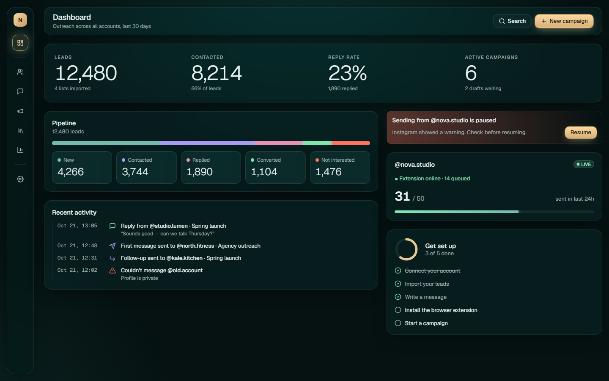

# Agent Skills

Reusable, product-neutral skills for coding agents. Each skill keeps its core instructions in `SKILL.md`, routes deeper guidance through focused references, and includes examples or assets when they materially help implementation.

## Available skills

| Skill | Version | Purpose |
|---|---:|---|
| [Teal Glass UI](teal-glass-ui/README.md) | 2.0.0 | Build, restyle, or review refined teal-black interfaces with restrained glass, champagne-gold emphasis, semantic jewel accents, and optional orb graphs. |



## Install

Clone the repository:

```bash
git clone https://github.com/KasraK2K/Skills.git
cd Skills
```

Then copy the complete skill directory into the location used by your agent. Keep the directory intact so `SKILL.md` can load its references, examples, and assets.

| Agent | User-level location | Project-level location |
|---|---|---|
| Codex | `~/.agents/skills/teal-glass-ui/` | `.agents/skills/teal-glass-ui/` |
| Claude Code | `~/.claude/skills/teal-glass-ui/` | `.claude/skills/teal-glass-ui/` |
| Gemini CLI | `~/.agents/skills/teal-glass-ui/` | `.agents/skills/teal-glass-ui/` |

Gemini CLI contributors can also link the checkout directly:

```bash
gemini skills link ./teal-glass-ui
```

Clients that accept local skill packages can use [`teal-glass-ui.skill`](teal-glass-ui/teal-glass-ui.skill). The unpacked folder remains the source of truth.

## Use

Explicitly ask the agent to apply the skill so the visual direction is intentional:

```text
Use $teal-glass-ui to restyle this dashboard while preserving its behavior,
responsive layout, and accessibility.
```

- In Codex, invoke `$teal-glass-ui` or name the style in your request.
- In Claude Code, invoke `/teal-glass-ui` or name the style in your request.
- In Gemini CLI and other Agent Skills-compatible tools, ask the agent to use `teal-glass-ui`.

See the [skill README](teal-glass-ui/README.md) for design tokens, screenshots, example prompts, and detailed compatibility notes.

## Repository structure

```text
Skills/
├── README.md
└── teal-glass-ui/
    ├── SKILL.md
    ├── README.md
    ├── agents/
    ├── references/
    ├── examples/
    ├── images/
    └── teal-glass-ui.skill
```

Within a skill:

- `SKILL.md` defines its trigger, workflow, boundaries, and reference routing.
- `references/` contains detailed guidance loaded only when relevant.
- `examples/` contains runnable, framework-neutral demonstrations.
- `images/` contains documentation previews.
- `agents/` contains optional agent-specific presentation metadata.
- `.skill` is the packaged distribution artifact.

## Development

When changing a skill:

1. Keep `SKILL.md` concise and move detailed guidance into focused references.
2. Preserve product neutrality and avoid tool-specific assumptions in canonical instructions.
3. Validate frontmatter, relative links, and packaged contents.
4. Run or open the included examples and inspect representative desktop and mobile layouts.
5. Rebuild the `.skill` package after source changes so it matches the folder.

Skill-specific contribution and verification guidance lives in each skill's README and references.
