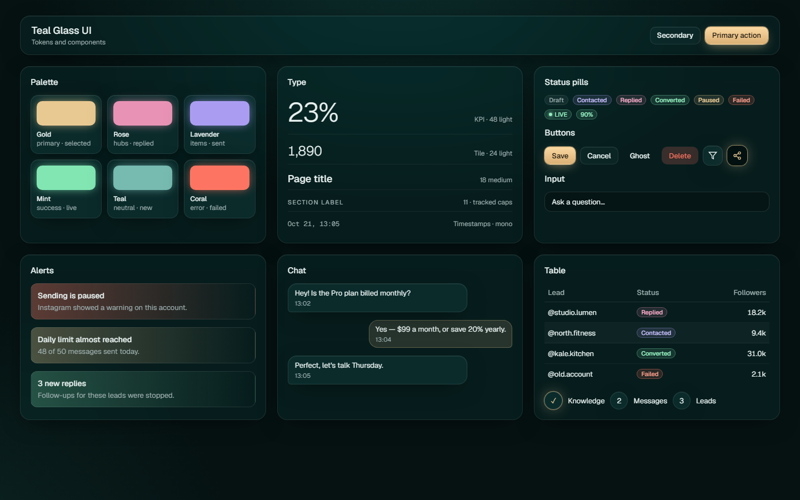
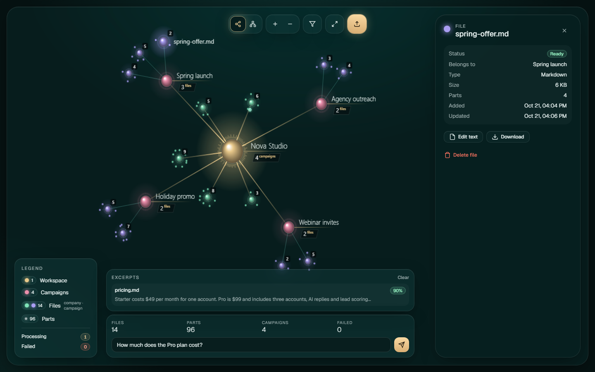

# Teal Glass UI

An open Agent Skill for building refined teal-black interfaces with restrained frosted glass, champagne-gold emphasis, semantic jewel accents, thin-number KPIs, and an optional glowing orb graph.


## Why this version is portable

`teal-glass-ui` follows the open Agent Skills folder format: a required `SKILL.md`, focused references loaded on demand, optional UI metadata, and runnable examples. The canonical source avoids tool-specific commands in its instructions.

It works natively with:

| Agent | Install location or command | Invoke |
|---|---|---|
| Codex | User: `~/.agents/skills/teal-glass-ui/` · Repo: `.agents/skills/teal-glass-ui/` | `$teal-glass-ui` or ask for the style |
| Claude Code | User: `~/.claude/skills/teal-glass-ui/` · Repo: `.claude/skills/teal-glass-ui/` | `/teal-glass-ui` or ask for the style |
| Gemini CLI | User: `~/.agents/skills/teal-glass-ui/` · Repo: `.agents/skills/teal-glass-ui/` · Dev: `gemini skills link ./teal-glass-ui` | Ask Gemini to use `teal-glass-ui` |

Other tools can use the same folder when they support the [Agent Skills specification](https://agentskills.io/specification). For tools that do not support Agent Skills, attach `SKILL.md` as explicit project instructions and make the `references/` files available; automatic discovery and progressive loading are tool-dependent.

The folder is the source of truth. `teal-glass-ui.skill` is a packaged archive for clients that accept local `.skill` packages.

## What it looks like

### Dashboard

A calm data hierarchy: compact glass header, one KPI strip, an analytical main column, an operational side column, semantic status color, and one gold primary action.


### Tokens and components

The palette, type scale, pills, buttons, fields, alerts, chat bubbles, table rows, and step markers.



### Orb relationship graph

Gold center, rose hubs, lavender and mint items, quiet edges, grouped glass controls, a legend, and a near-opaque detail panel.



## Skill structure

```text
teal-glass-ui/
├── SKILL.md
├── agents/
│   └── openai.yaml
├── references/
│   ├── foundation.md
│   ├── components.md
│   ├── orb-graph.md
│   └── quality-checks.md
├── examples/
│   ├── glass.css
│   ├── dashboard.html
│   ├── components.html
│   └── graph.html
├── images/
└── teal-glass-ui.skill
```

- `SKILL.md` is the concise trigger, workflow, and reference router.
- `references/foundation.md` covers tokens, surfaces, typography, motion, stack adaptation, and theming boundaries.
- `references/components.md` covers shells, dashboards, forms, tables, chat, alerts, and floating controls.
- `references/orb-graph.md` covers hierarchy, rendering, layout, interaction, performance, and accessibility.
- `references/quality-checks.md` is the responsive, accessibility, visual, performance, and engineering gate.
- `examples/` contains standalone framework-neutral HTML/CSS that can be opened locally.

## Design system at a glance

| Role | Value | Use |
|---|---|---|
| Background | `oklch(0.17 0.018 200)` | Teal-black canvas with broad radial light |
| Glass | `oklch(0.32 0.04 195 / 0.28)` | Major floating surfaces |
| Gold | `#e9c98b` | Primary, selected, focus, graph center |
| Rose | `#ec8fac` | Highlight, hub, replied |
| Lavender | `#a99df2` | Secondary category, contacted, sent |
| Mint | `#7fe3b8` | Success, active, ready |
| Teal | `#5fb8ad` | Neutral, new, draft |
| Coral | `#ff7a6b` | Error, failed, destructive |

Key rules:

- The user chooses the style; a generic dashboard request does not trigger it.
- Preserve the host project's framework, behavior, theme contracts, and component APIs.
- Use glass, glow, and saturated color as hierarchy—not decoration.
- Keep required information out of hover-only interactions.
- Verify real desktop and mobile rendering, focus, reduced motion, and representative contrast.
- Stop graph animation when idle.

## Example prompts

```text
Use $teal-glass-ui to restyle this dashboard while preserving its behavior,
current data, responsive layout, and accessibility.
```

```text
Use teal-glass-ui to build a full-bleed relationship graph for this hierarchy.
Read the graph reference, keep the existing API model, and include an accessible
list or detail representation for essential data.
```

```text
Audit this page against the teal-glass-ui system. Report concrete visual,
responsive, accessibility, and performance mismatches before editing.
```

## Development

Open any file in `examples/` in a browser. When changing the skill:

1. Keep `SKILL.md` concise and route detail to the relevant reference.
2. Validate frontmatter and relative links.
3. Run the standalone examples and inspect desktop plus narrow viewports.
4. Rebuild `teal-glass-ui.skill` so the package matches the source folder.

## Origin

The system began as a production-inspired dark glass direction and has been rewritten as a product-neutral, cross-agent design skill. Preview data is fictional.
